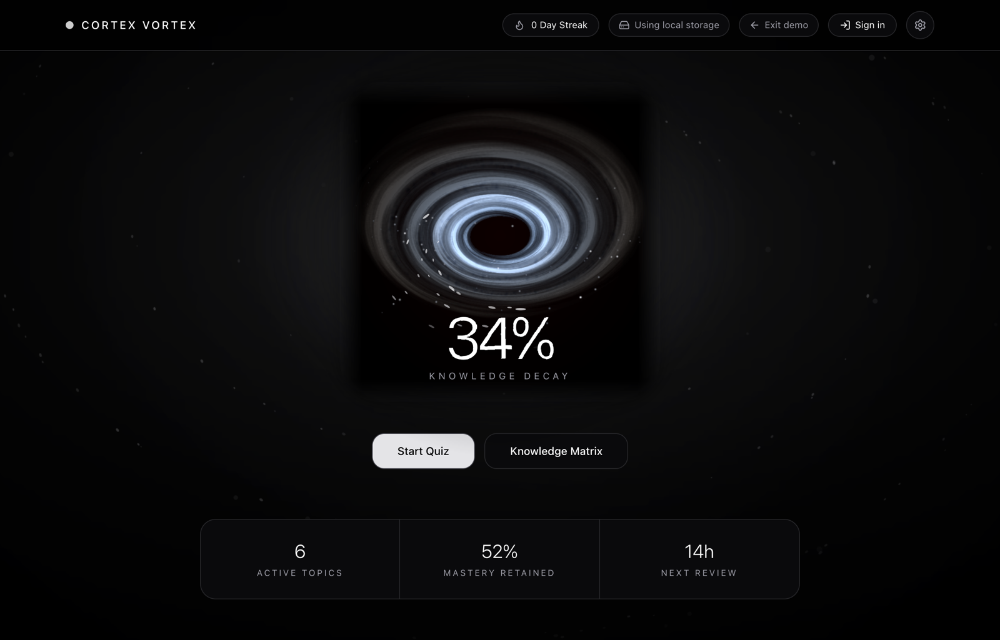
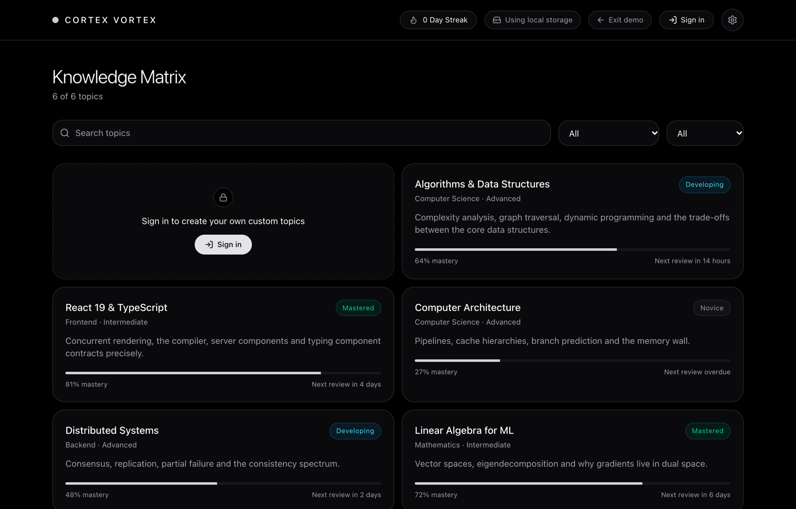
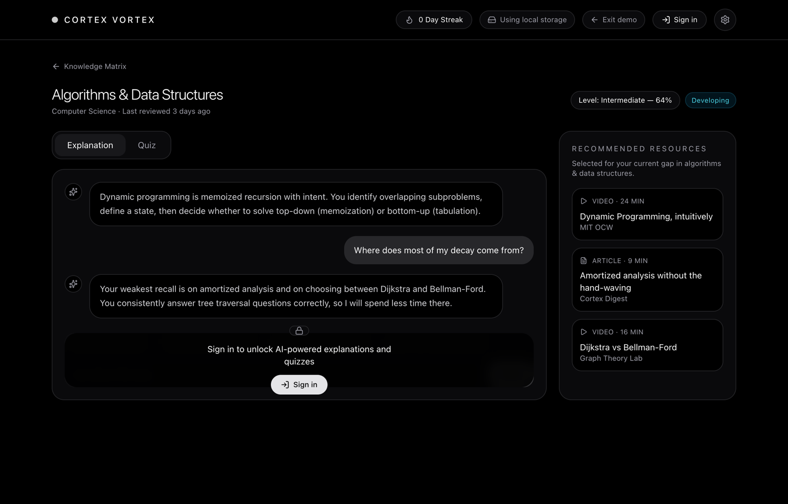
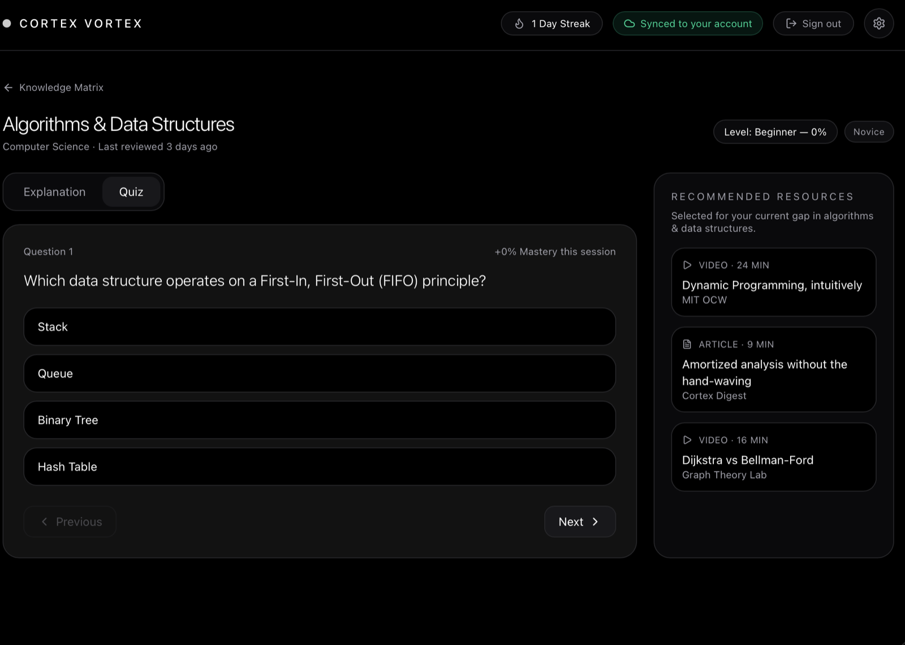

# Cortex Vortex

[](https://github.com/Simons-Github/cortex-vortex/actions/workflows/ci.yml) [](LICENSE)

A study app that shows how much of each topic you are forgetting and uses AI explanations and quizzes to bring it back.

**Live demo:** [vortex.berger-labs.com](https://vortex.berger-labs.com). Click **Explore demo** to try it with sample data and no account. The AI features need a sign-in.



## Features

- Dashboard with an animated 3D vortex that reacts to your overall knowledge decay, plus a daily streak
- Knowledge Matrix with mastery per topic, search and filters
- Study room with an explanation chat and an adaptive multiple-choice quiz
- Custom topics, checked by Gemini before they are created
- Attach a PDF to a custom topic as study material (needs your own Gemini key)
- Sign in with email or Google. Progress from the demo is merged into your account.
- Optional: use your own Gemini API key instead of the shared daily limit

<p>
  
  
  
</p>

## Tech stack

| | |
| --- | --- |
| Frontend | React 19, TypeScript, TanStack Start, Router and Query, Tailwind CSS 4, shadcn/ui |
| 3D | three.js with react-three-fiber |
| Backend | TanStack Start server functions on Vercel |
| Database and auth | Supabase (Postgres, Row Level Security, RPCs) |
| AI | Google Gemini, called only on the server |
| Tooling | Playwright, ESLint, GitHub Actions |

## How it works

```
Browser (React)
  ├── Supabase client     -> Auth, Postgres (RLS, RPCs)
  └── Server functions    -> Gemini: explain, quiz, create topic
                             checks the quota through RPCs first
```

There is no separate REST backend. Without Supabase or Gemini configured, the app falls back to mock data and `localStorage`, which is also how the demo works.

Some decisions I made along the way:

- **Gemini only runs on the server.** The API key never reaches the browser, and the server functions are protected by a CSRF check.
- **Clients can't write directly.** Mastery, streaks, custom topics and quiz attempts are read-only for the client. Every write goes through a Postgres function (`SECURITY DEFINER`), so the database decides what a user is allowed to change. The catch is that some rules, like how much mastery a quiz adds, live in SQL and have to stay in sync with the TypeScript code.
- **Limits are enforced in Postgres.** Every user gets 5 AI requests per day, plus short burst limits per endpoint. Both are reserved atomically in the database, so they hold even with several Vercel instances running. Users with their own key skip the daily limit.
- **Own API keys are encrypted.** They are stored with AES-256-GCM in a schema that the Supabase Data API doesn't expose, and only the server can decrypt them. More in [docs/security.md](docs/security.md).

## Running locally

You need Node.js 22 or newer.

```sh
git clone https://github.com/Simons-Github/cortex-vortex.git
cd cortex-vortex
npm install
npm run dev        # http://localhost:8080
```

This runs the demo with mock data. For sign-in and AI, copy `.env.example` to `.env` and set up Supabase as described in [docs/development.md](docs/development.md) and [docs/database.md](docs/database.md).

## Tests

Playwright tests in `e2e/` cover the demo path: landing page, dashboard, matrix, study room and settings. Run them with `npm run test:e2e`. CI runs them together with lint, type check and build on every push. A few small scripts in `scripts/` check the key encryption, PDF limits, error redaction and topic moderation.

## Limitations

- The end-to-end tests don't cover the signed-in AI flows.
- Topic moderation runs in the app server. Someone calling the Supabase RPC directly could skip the Gemini check, but not the quota.
- One PDF per topic, up to 5 MB and 20 pages, without OCR. Quizzes use a short summary of the PDF, not the full text.
- The encryption secret for stored keys can't be rotated without users entering their keys again.

## License

MIT
